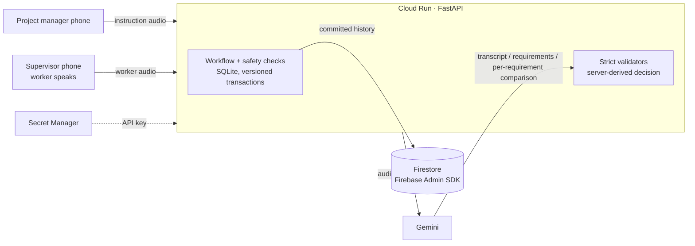

# EchoCheck AI

**Confirm that a shop-floor worker understood an instruction — before the work starts.**

A project manager gives a spoken instruction. On the floor, a supervisor holds a phone while the worker — who has no login and no device — explains the task back in their own words. **Gemini** transcribes the worker and compares what they said with every requirement the manager approved. Wrong quantities, skipped checks, reversed steps, wrong destinations and extra work are shown side by side with the worker's own words. The supervisor explains the correction, the same worker explains again, and only a matching explanation plus two human confirmations completes the check.

AI Builder Cup 2026 · Manufacturing: Intelligent Operations & Industrial Efficiency · Team TwoGood

## Try it

**Live prototype:** https://echocheck-ai-914156466613.asia-southeast1.run.app

| View | Username | Password |
| --- | --- | --- |
| Admin (can switch views) | admin | admin123 |
| Project manager | manager | manager123 |
| Supervisor | supervisor | super123 |

These are public prototype accounts. Prototype release to real work is disabled.

**Two-minute path (no microphone needed)**

1. Sign in as **Supervisor** and open a task marked **Demo**, e.g. *Cartons and bottles*. Play the manager's instruction.
2. Choose **Incorrect understanding** → **OK — compare this example**. Each requirement shows *what the project manager asked* next to *what the worker said*.
3. Acknowledge the suggested correction, choose **Correct after correction**, and compare again. Confirm as Supervisor, then switch to Project manager (Admin → *View as*) and confirm the instruction.
4. Under **Live Gemini check**, pick any sample and press **Run live Gemini check**: the sample voice is sent to Gemini, transcribed and compared live with every requirement. The result shows Gemini's transcript, per-requirement evidence and latency, and whether it agrees with the prepared result.

**Live voice path (microphone):** as Project manager, create a task, record the instruction, review the requirements Gemini extracted and publish. As Supervisor, enter the worker's name, confirm their consent, and record the worker explaining the task.

## Google Cloud services

| Service | How EchoCheck uses it |
| --- | --- |
| **Gemini** (Gemini API, structured JSON output) | Transcribes instruction and worker audio verbatim; extracts atomic requirements from the manager's instruction for human review; compares the worker's explanation with every requirement, quoting the worker's exact words as evidence. The server re-validates every response and derives the decision itself — the model cannot return its own pass. |
| **Cloud Run** | Runs the FastAPI service and web app from this repository's Dockerfile (built by Cloud Build), with FFmpeg for browser audio validation. |
| **Firestore** via the **Firebase Admin SDK** | Durable, append-only copy of the workflow audit trail, demo activity and task/demo status (`echocheck_audit_events`, `echocheck_demo_events`, `echocheck_tasks`, `echocheck_demo_runs`). Deterministic document ids make retries idempotent. No audio or transcripts are copied. |
| **Secret Manager** | Holds the Gemini API key; only the Cloud Run runtime identity can read it. |



## Safety design

- **Human in the loop.** AI never approves work. A pass only makes a task eligible for separate Project manager and Supervisor confirmations of that exact instruction version and worker recording.
- **Strict AI boundaries.** Every requirement must be covered exactly once; every quote must appear verbatim in the transcript; uncertainty or extra actions block a pass; model-supplied pass flags are ignored.
- **Fresh evidence.** After a correction the same worker must record again; reused audio is rejected; new recordings or instruction revisions clear earlier confirmations.
- **Consent.** The supervisor confirms the named worker heard the recording notice and agreed before capture.
- **Demo isolation.** Prerecorded samples and prepared comparisons are labelled, kept in separate tables and cannot create worker evidence or release work. The Live Gemini check is practice only.
- **Cost bounds.** Live AI use is capped per session per hour and per day.

## Honest limits

This is a prototype. The seven demos use synthetic English voices; there is no field accuracy, noise-robustness, multilingual or incident-reduction result yet. The workflow store is SQLite inside a single Cloud Run instance (live tasks reset if the instance is replaced; demos reload automatically; history persists in Firestore). Release to real work is disabled. The production persona flow and a full Firestore-native store are future work.

## Run locally

```sh
python3 -m venv .venv
.venv/bin/python -m pip install -r requirements-dev.txt
.venv/bin/python -m uvicorn backend.main:app --host 127.0.0.1 --port 8000 --reload
```

Open http://localhost:8000. The `.prototype-enabled` marker selects prototype mode; demos need no API key. For live voice processing set `PROVIDER_PROCESSING_ENABLED=true`, `GEMINI_MODEL` and `GEMINI_API_KEY` in the process environment (see `.env.example`; it is not loaded automatically). Browser recordings (WebM/Ogg/MP4) need FFmpeg on the server; the container includes it.

## Tests

```sh
.venv/bin/python -m pytest -q -W error -p no:cacheprovider
```

Tests use temporary databases and fake providers (`tests/conftest.py` keeps them away from `work/`). They cover the workflow state machine, consent, worker attribution, the correction cycle, stale approvals, failure handling, the seven demos, live-check isolation and budgets, the Firestore mirror and container packaging.

## Deploy

```sh
GEMINI_MODEL=<model-id> deploy/cloudrun.sh
```

Requires `gcloud auth login`, a project with billing and a Secret Manager secret `gemini-api-key`. The script enables the APIs, creates the Firestore database, grants the runtime identity only Firestore and secret access, and deploys one Cloud Run instance. `scripts/benchmark_live.py <url>` runs all 28 sample clips through the live Gemini check and writes `docs/LIVE-BENCHMARK.md`.

## Repository map

`backend/main.py` auth and live workflow · `backend/demo.py` prerecorded demos and live sample checks · `backend/gemini_adapter.py` Gemini calls · `backend/verification.py` strict validators · `backend/firestore_mirror.py` Firestore history · `backend/store.py` SQLite schema · `frontend/` mobile-first web app · `dataset/demo_scenarios_v1.json` demo catalog · `backend/demo_assets/` sample audio · `docs/` validation history.
