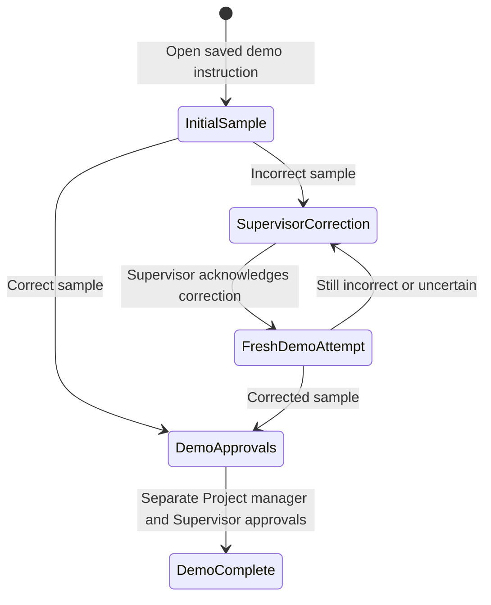

# Scripted demonstration catalogue

The seven scenarios in `dataset/demo_scenarios_v1.json` are fictional examples of packing, labelling, counting, and handoff communication. Each has one Project manager instruction, three or four reviewed example requirements, and four worker retellings. All scripts are English.

The user explicitly approved an isolated prototype demonstration with saved synthetic voices and predetermined comparisons. These examples do not establish real recording consent, voice identity, model accuracy, workplace instructions, or permission to work. The interface must identify them as **Demo · synthetic voices · scripted comparison**. A comparison may pass within the demonstration; release to work must remain unavailable.

## Scenarios

| ID | Example | Initial incorrect sample | Still incorrect after correction |
| --- | --- | --- | --- |
| `demo-01-carton-quantities` | 12 cartons, 24 bottles each, blue labels | Carton and per-carton quantities are reversed; equal total is insufficient | Per-carton quantity remains wrong |
| `demo-02-every-carton` | Check every carton, then add its sticker; set damaged cartons aside | Checks only one carton after sealing; stickers applied too soon; damaged-carton requirement omitted | Sticker order remains wrong |
| `demo-03-lot-labels` | Blue labels saying Lot A17; keep A71 separate | Wrong colour, transposed lot code, mixed lots | Lot code remains A71 |
| `demo-04-order-and-time` | Count before sealing; bay 2 by 14:30 | Reverses the sequence and changes deadline to 15:30 | Deadline remains 15:30 |
| `demo-05-destination-and-extras` | Move eight sealed cartons to bay 7 without changing seals or labels | Wrong destination and an unrequested additional movement | All listed requirements match, but the extra movement remains |
| `demo-06-sorting-and-negation` | Count 12 empty cartons; separate sizes; exclude red tags | Reverses separation and count exclusion | Red-tag exclusion remains reversed |
| `demo-07-uncertain-quantity` | Ten trays, six parts each, separate B12, white labels | Reverses quantities and mixes lots | Explicitly unsure whether a tray needs six or ten parts |

Every `correct` and `corrected` variant has the expected decision `passed`. The `incorrect` variants have `discrepancy`. Six `still_incorrect` variants have `discrepancy`; the final scenario has `review_required` because the speaker explicitly remains unsure.

## Data contract

The catalogue has `schema_version`, `catalog_id`, `activation_status`, `source`, `evidence_kind`, `language`, `disclosure`, and `scenarios`. Scenario IDs and variant keys are stable. The four variant keys are exactly `correct`, `incorrect`, `corrected`, and `still_incorrect`.

Each scenario contains a title, coverage tags, a fictional worker reference, an instruction with its transcript and requirements, a correction suggestion, and the four variants. Each variant contains:

- `transcript`: the full, fixed sample script.
- `evaluation`: the existing strict provider response shape: one status and an exact quotation for each requirement, `complete`, `extra_actions`, `uncertainties`, and `summary`.
- `expected_decision` and `expected_pass`: catalogue expectations, kept outside the strict response.
- `audio_asset`: relative path, MIME type, provenance, generation status, and checksum placeholder.

The validator derives the decision and pass flag from the raw evaluation; fixture-authored pass flags never enter the strict response. Catalogue validation checks full requirement coverage and exact transcript quotations. These checks establish structural consistency of scripted examples, not a language-model benchmark.

## Audio assets

There are 35 planned WAV files: one instruction plus four retellings for each scenario. Resolve the catalogue's relative audio paths only beneath `backend/demo_assets/`:

```text
backend/demo_assets/audio/<scenario_id>/instruction.wav
backend/demo_assets/audio/<scenario_id>/correct.wav
backend/demo_assets/audio/<scenario_id>/incorrect.wav
backend/demo_assets/audio/<scenario_id>/corrected.wav
backend/demo_assets/audio/<scenario_id>/still_incorrect.wav
```

The 35 synthetic WAV files are generated. Each catalogue asset is marked `generation_status: generated`, has `origin: synthetic_tts`, and includes its actual SHA-256. The generated asset manifest is authoritative for packaged availability and integrity:

```json
{
  "schema_version": 1,
  "files": {
    "audio/<scenario_id>/instruction.wav": {
      "sha256": "<actual audio hash>",
      "bytes": 0,
      "mime": "audio/wav",
      "transcript_sha256": "<SHA-256 of the UTF-8 script>"
    }
  }
}
```

The zero byte count above is a schema example; generated entries must contain actual positive sizes. Audio delivery must authenticate the assigned viewer, select a server-known scenario and variant, enforce the manifest allowlist, and reject missing or modified assets. The client must never supply a filesystem path.

## Evidence and transitions

Demo runs and attempts must carry their own source marker, fixture version, selected scenario and variant, and a unique attempt identifier. They must not create rows claiming real worker consent or real microphone recording. Reuse the existing three prototype accounts; fictional workers are labels in sample evidence, not new logins. An Admin perspective change must retain the underlying Admin principal in the audit trail.

Each demo opens with its saved Project manager instruction prepared for inspection. This is preset example content, not a fabricated human approval or real instruction publication. The assigned Supervisor selects a correct or incorrect initial worker sample. A passing sample still needs separate approvals by the Project manager and Supervisor. An incorrect sample requires the Supervisor's acknowledgment of the discrepancy and correction before either post-correction sample is accepted.



After a still incorrect sample, another Supervisor acknowledgment must precede another corrected sample. Every selection creates a new demo attempt bound to the current instruction version and acknowledgment; an acknowledgment never edits the old comparison into a pass. Changing evidence clears old approvals. Stale actions fail rather than applying to a newer attempt. Demo completion is an illustrative end state with no work-release permission.

## Verification matrix

- Validate all seven scenarios and all 28 comparison payloads; ensure three or four unique requirements, exact quotations, the expected decisions, and five audio paths per scenario.
- Seed seven marked demo tasks idempotently without creating a fourth account, fabricated consent, or real recording evidence.
- Run the full incorrect → Supervisor acknowledgment → still incorrect → new acknowledgment → corrected → separate approvals loop while the live provider is unconfigured and microphone APIs are unavailable.
- Reject post-correction samples before acknowledgment, Project manager acknowledgment, base Admin mutation, stale versions, stale CSRF tokens, and unassigned access.
- Preserve attempts, acknowledgments, approvals, and principal identity across perspective changes and restarts.
- Keep demo endpoints unavailable outside prototype mode; reject demo evidence at real recording, approval, and release boundaries.
- Authenticate and allowlist audio assets; fail closed if a required file or its integrity manifest entry is missing.

The original 100-row dataset is marked provisional/unreviewed and is not the expected-results source for this catalogue. The legacy six-field local parser cannot evaluate these generic requirements and must not grade the demonstrations.
